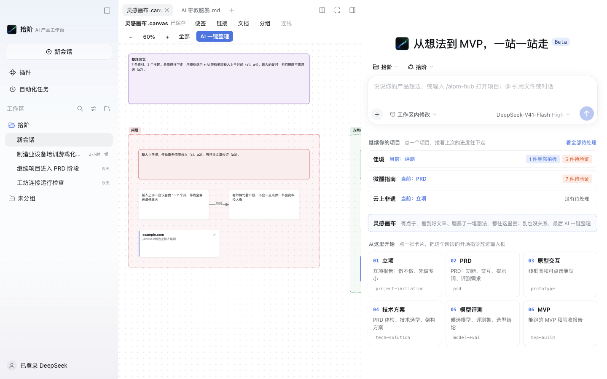
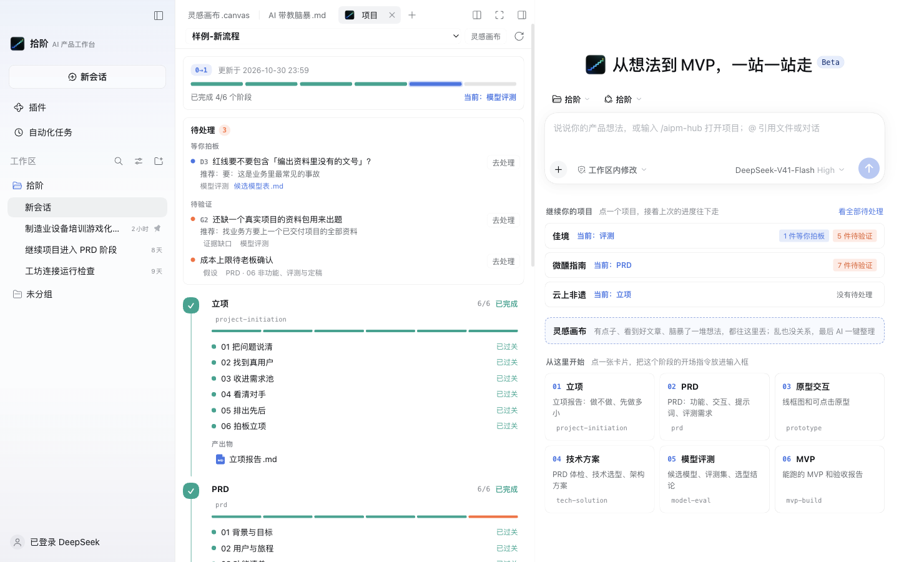
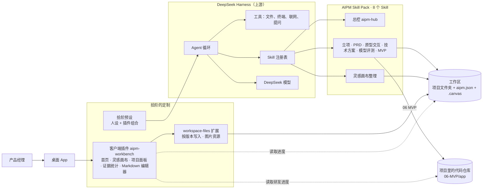

<p align="center">
  
</p>

<h1 align="center">拾阶</h1>

<p align="center"><b>AI 产品工作台 · 一步步把想法做成 MVP</b></p>

<p align="center">
  基于 DeepSeek 开源的 Agent 框架 <a href="https://github.com/deepseek-ai/deepseek-harness">DeepSeek Harness</a> 二次开发 · 默认使用 DeepSeek 模型 · macOS 桌面端
</p>



## 为什么做

通用的 AI 对话也能写 PRD，但它不知道 AI 产品经理的活是怎么一步步推进的：哪一步该拍板、结论要有什么证据、上一步的产出怎么交给下一步。结果往往是一份看起来完整、其实经不起追问的文档，离能跑的产品更远。

拾阶把这些固化下来：

- **流程**：立项 → PRD → 原型交互 → 技术方案 → 模型选型与评测 → MVP，六个节点，每个节点由一个专门的 Skill 带着走，节点里分 4–6 站，每站有关卡、有模板、有自检。节点不要求死板按顺序走：总控看哪个假设最危险来推荐下一步，比如 PRD 没写完就先做半天模型小样。
- **灵感画布**：有点子、看到好文章、脑暴了一堆想法，随时往一张无限画布上丢，乱也没关系；点「AI 一键整理」，AI 读完全部节点、打开链接、按主题分组写回画布，再问你要不要开项目。画布不是必经步骤。
- **证据纪律**：每个结论标来源（用户原话、行为数据、公开资料、测算、AI 推断……），没证据的标「待验证」，不编造。每份产出物的证据构成在界面上一眼可见。
- **进度和待办可见**：每个项目一个 `aipm.json`，首页和「项目」面板实时显示走到哪一站、哪些事等你拍板、哪些假设还没验证、MVP 代码做到哪了。
- **一路做到能跑**：PRD 里写的提示词就是评测的被测对象，评测选定的模型回填技术方案，技术方案的开发分期就是 MVP 的阶段，评测集最后在 MVP 的真实链路上再跑一遍。

## 六个节点

| 节点 | Skill | 站 | 产出物 |
|---|---|---|---|
| 01 立项 | `project-initiation` | 把问题说清 / 找到真用户 / 收进需求池 / 看清对手 / 排出先后 / 拍板立项 | 立项报告：做不做、先做多小、怎么算成、什么情况下停 |
| 02 PRD | `prd` | 背景与目标 / 用户与旅程 / 功能清单 / 功能需求与交互 / AI 设计 / 非功能、评测与定稿 | PRD：需求背景维度表、北极星与四层目标、单句验收标准、入口 / 交互 / 反馈、全局上下文与每个 Agent 的提示词、埋点、权限、非功能、评测需求、兜底策略 |
| 03 原型交互 | `prototype` | 页面清单 / 线框图 / 可点击原型 / 走查回写 | 线框图、可点击原型（含 AI 的等待、流式、失败、兜底状态），页面编号回写进 PRD |
| 04 技术方案 | `tech-solution` | PRD 体检 / 技术适配 / 架构设计 / 评审定稿 | PRD 补全清单、技术适配声明、技术方案（Agent 判断与组件选型、七层架构、接口、上下文与提示词落地、成本测算、开发分期）、决策台账 |
| 05 模型选型与评测 | `model-eval` | 定目标 / 候选模型调研 / 定标准 / 建评测集 / 跑评测 / 归因与报告 | 候选模型表、评测方案、评测集（正常 / 边界 / 红线 / 反例，每题三次都过才算过）、评测报告与每个环节的选型 |
| 06 MVP | `mvp-build` | 开发准备 / 后端 MVP / 前端风格 / 正式前端 / 联调验收 | 能跑的 MVP 代码仓库、每阶段的证据包、验收报告 |
| 灵感画布 | `idea-canvas` | 读画布 / 打开链接 / 定性 / 分主题 / 写回画布 / 整理稿 / 问去向 | 整理后的画布、整理稿 |

总控 `aipm-hub` 负责新建和打开项目、讲进度、按风险推荐下一步、处理待办，以及新需求来了以后的升版顺序（PRD → 技术方案 → 评测 → MVP）。全部 8 个 Skill 都在 [AIPM Skill Pack](https://github.com/ZeroOnehub/aipm-skill-pack)，都是我自己写的。

## 从方案到 MVP

拾阶里的 AI 能直接把 MVP 写出来：

1. **代码仓库建在项目里**：`mvp-build` 在 `<项目>/06-MVP/app/` 建一个独立的 Git 仓库，放进规则卡 `AGENTS.md`（十条底线、阶段闸门是否表、证据包）、技术栈 / 前端 / 上线部署三份手册、自检脚本 `verify.sh`、拾阶交接的 PRD / 技术方案 / 评测集 / 原型、从 PRD 抽出的提示词、技术方案选中的 Agent 参考组件。
2. **后端按技术方案分期**：每期用评测集的题在真实链路上冒烟，测试、密钥、重启恢复、前端构建、文件齐全五项由 `verify.sh` 判。
3. **前端先挑风格**：AI 上网找 3–4 个参考，把你的产品代表页做成几种风格放在一页里，你挑定后写成设计规范，再做正式前端。
4. **联调验收**：评测集走产品的真实链路、PRD 功能清单逐条对照、兜底逐条触发，写验收报告。
5. **也可以交给别的编码 AI**：用 Claude Code、Codex 打开 `app/`，规则卡对它们同样有效；项目面板的「研发进度」卡照样看得到做到哪、有没有没过的检查。



## 主要功能

- **首页**：新会话的输入框下面先列出最近的项目，每个显示当前节点和「几件等你拍板 / 卡住 / 待验证」，点一下接着上次的进度走；然后是灵感画布入口；再往下是六张节点卡片，点一张把这个节点的开场指令放进输入框。
- **灵感画布**：无限画布，便签、链接、文档、图片、分组随便放，可以连线、上色、拖动、缩放；粘贴网址自动变链接卡片，粘贴图片直接放进来；自动保存。文件是开放的 JSON Canvas 格式（`.canvas`），Obsidian 也能打开。工作区一张总画布，每个项目也可以有自己的画布。
- **项目面板**：总进度条、MVP 研发进度、待处理列表和六节点时间线。待处理把等你拍板的决定、卡住的站、待验证的假设集中列出，点「去处理」就放进输入框；时间线显示每个节点的 Skill、各站关卡状态和产出物。
- **证据构成**：每份 Markdown 产出物后面有一条色条，绿色是硬证据，黄色是线索，红色是冲突，紫色是测算、模拟、AI 推断这类还不能当依据的。
- **Markdown 所见即所得编辑**：产出物直接在拾阶里改，证据标签按颜色高亮；粘贴截图自动存到文档旁边，⌘S 保存；选中一段文字「发给 AI」；AI 和你同时改了同一个文件时会提示冲突，不会互相覆盖。
- **老项目照常可用**：老的六阶段项目原样显示，总控会问要不要升级到新流程（文件一个不删）。
- **独立的桌面 App**：自己的名称、图标和数据目录（`~/.aipm-studio`），和官方 DeepSeek Harness 互不干扰。

## 架构



DeepSeek Harness 的「一切皆插件」架构让定制不需要改核心：工作台的界面是一个客户端插件，人设和插件组合是一份预设，方法论全部放在 Skill 里。

## 我改了哪些地方

| 位置 | 内容 |
|---|---|
| `packages/client/aipm-workbench/` | 客户端插件：品牌、首页（继续你的项目、灵感画布入口、六节点卡片）、灵感画布标签页、项目面板（研发进度、待处理、时间线）、证据统计、Markdown 编辑器 |
| `packages/bundle/web-app/presets/aipm.patch.yml` | 拾阶预设：人设与插件组合 |
| `packages/api/workspace-files/` | 新增按版本校验的文本写入和图片资源写入，供编辑器和画布使用 |
| `packages/client/ui-conversation/` | 新增首页底部插槽 `conversation.hero.footer`；首页文案 |
| `packages/client/ui-layout/` | 文件面板居中、对话在右的布局 |
| `apps/desktop/` | App 名称、图标、默认工作区；图标替换脚本 `scripts/set-aipm-icon.sh` |
| [`AIPM工坊.md`](AIPM工坊.md) | 本机使用说明 |

## 快速开始

需要 macOS、Node.js 24 以上和 pnpm（通过 corepack 启用）。

```bash
git clone https://github.com/ZeroOnehub/aipm-workbench.git
cd aipm-workbench
pnpm install
pnpm run build

# 用独立的数据目录启动桌面端
DSH_HOME="$HOME/.aipm-studio" \
DSH_DESKTOP_USER_DATA_DIR="$HOME/Library/Application Support/AIPM工坊" \
DSH_DESKTOP_OPEN_DEVTOOLS=0 \
pnpm run start:desktop
```

首次启动后在设置里登录 DeepSeek 或填写 API Key，然后在左侧新建一个工作区，指向你存放项目的文件夹。

装上 Skill：

```bash
git clone https://github.com/ZeroOnehub/aipm-skill-pack.git
aipm-skill-pack/install.sh --workspace "<你的工作区>"
```

品牌图片采用「拾阶」阶梯 Logo，呼应从想法到产品的六个节点。名称和界面已更新，原有数据目录、项目格式和 `/aipm-hub` 指令继续兼容。

换 App 图标：`apps/desktop/scripts/set-aipm-icon.sh <logo.png>`；带透明圆角的成品图加 `--no-mask`。脚本同步生成桌面图标、欢迎页、首页与侧栏标志、网页图标，重新构建并启动后生效。

## 与上游同步

```bash
git remote add upstream https://github.com/deepseek-ai/deepseek-harness.git
git fetch upstream && git merge upstream/master
```

## 致谢与许可

基于 [DeepSeek Harness](https://github.com/deepseek-ai/deepseek-harness)（MIT，© 2026 DeepSeek）。上游项目的原始说明见 [README.zh.md](README.zh.md)，第三方依赖见 [THIRD_PARTY_NOTICES.md](THIRD_PARTY_NOTICES.md)。本仓库沿用 [MIT](LICENSE) 协议。
