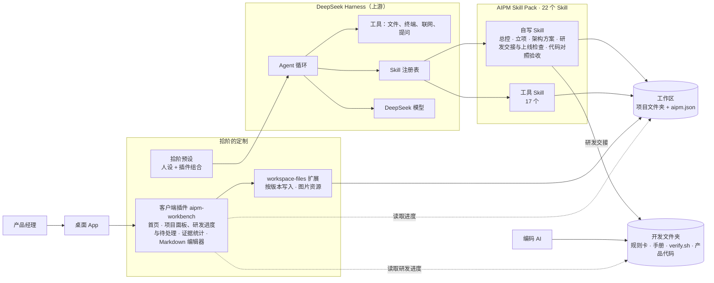

<p align="center">
  
</p>

<h1 align="center">拾阶</h1>

<p align="center"><b>AI 产品工作台 · 一步步把想法做成产品</b></p>

<p align="center">
  基于 DeepSeek 开源的 Agent 框架 <a href="https://github.com/deepseek-ai/deepseek-harness">DeepSeek Harness</a> 二次开发 · 默认使用 DeepSeek 模型 · macOS 桌面端
</p>


## 为什么做

通用的 AI 对话也能写 PRD，但它不知道产品经理的工作是怎么一步步推进的：哪一步该拍板、结论要有什么证据、上一步的产出怎么交给下一步。结果往往是一份看起来完整、其实经不起追问的文档。

拾阶把这些固化下来：

- **流程**：立项 → PRD → 原型交互 → AI 方案设计 → 评测 → 上线复盘，六个阶段，每个阶段由专门的 Skill 带着走，有关卡、有模板、有自检。阶段不要求按顺序走：总控看哪个假设最危险来推荐下一步，比如 PRD 没写完就先做半天的 AI 可行性小样。
- **证据纪律**：每个结论标来源（用户原话、行为数据、公开资料、测算、AI 推断……），没证据的标「待验证」，不编造。每份产出物的证据构成在界面上一眼可见。
- **进度和待办可见**：每个项目一个 `aipm.json`，首页和「项目」面板实时显示走到哪一站、哪些事等你拍板、哪些假设还没验证。
- **方案一路接到代码**：方案定下来后，产品被交接到单独的开发文件夹，编码 AI 照规则卡分阶段写代码，每个阶段由自检脚本把关；拾阶的项目面板直接看得到开发做到哪、有没有没过的检查。

## 六个阶段

| 阶段 | 负责的 Skill | 产出物 |
|---|---|---|
| 01 立项 | `project-initiation`（访谈用 `interview-script`、整理用 `research-synthesis`）；已有代码的老产品先用 `code-check` 做存量体检 | 立项报告：做不做、先做多小、怎么算成、什么情况下停 |
| 02 PRD | `prd`，审查用 `prd-review` | PRD：价值主张、功能与验收标准、AI 能力边界（含 14 个 Agent 特征的判断）、评测样例 |
| 03 原型交互 | `html-wireframe` → `html-prototype` | 低保真线框图、可交互的高保真原型 |
| 04 AI 方案设计 | `agent-architecture` → `system-prompt-design` → `build-launch`，深入 Agent 机制用 `harness-patterns` | 架构方案（先判断要不要做成 Agent，再按固定规则从 17 个组件里选型，子代理独立审稿）、系统提示词、交接到开发文件夹的产品 |
| 05 评测 | AI 可行性小样 → `code-check`（对照验收）→ `eval-synthetic-data` → `eval-error-analysis` → `eval-judge-prompt` → `eval-validate-judge` | 小样结论、代码对照验收报告、测试集、错误分析、校准过的评委 |
| 06 上线复盘 | `build-launch` → `metrics-review` → `retro` | 上线检查（读开发文件夹的上线证据、埋点、灰度、上线是否表）、指标复盘、下一轮结论（对照立项时的预测） |

全部 22 个 Skill 都在 [AIPM Skill Pack](https://github.com/ZeroOnehub/aipm-skill-pack)：总控、立项、架构方案、研发交接与上线检查、代码对照验收 5 个是我自己写的，另外 17 个工具 Skill 改编自开源项目。

## 从方案到代码

拾阶不在工作区里写产品代码，但会把这一段接起来：

1. **写 PRD 时就问清 Agent 特征**：14 个特征（会不会做收不回的事、要不要记住用户、要不要定时触发……）用大白话问，结果写成 PRD 里的特征表。
2. **架构方案按固定规则选组件**：特征表直接喂给选型脚本，同样的判断永远得到同样的选型；方案写完另开一个子代理独立审稿。
3. **交接到开发文件夹**：`build-launch` 建一个开发文件夹（规则卡 `AGENTS.md`、通用技术栈 / 前端 / 上线部署三份手册、自检脚本 `verify.sh`），每个产品一个子文件夹，放进研发 PRD、决策台账、架构方案和选中组件的参考代码。用 Claude Code、Codex 等编码 AI 打开它，照规则走技术适配 → 后端 MVP → 正式前端 → 上线 → 收尾，每个阶段交证据包，测试、密钥、重启恢复、前端构建、文件齐全五项由脚本判。
4. **拾阶看得见开发进度**：项目面板上的「研发进度」卡直接读开发文件夹，显示做到哪个阶段、`verify.sh` 过没过、是否表里有没有「否」。
5. **新需求先回拾阶**：会改范围的新需求先升版 PRD，架构方案只重判受影响的特征并列出选型变化，再同步到开发文件夹，编码 AI 按「骨架待办」增量修改。`code-check` 随时可以拿 PRD 和方案对照代码，列出先修什么。


## 主要功能

- **首页：继续你的项目**：新会话的输入框下面先列出最近的项目，每个显示当前阶段和「几件等你拍板 / 卡住 / 待验证」，点一下接着上次的进度走；再往下是六张阶段卡片，点一张把这个阶段的开场指令放进输入框。
- **项目面板**：总进度条、研发进度、待处理列表和六阶段时间线。研发进度读开发文件夹，显示编码 AI 做到哪个阶段、最新证据包的检查结果；待处理把等你拍板的决定、卡住的站、待验证的假设集中列出，点「去处理」就放进输入框；时间线显示每个阶段负责的 Skill、各站关卡状态和产出物。
- **证据构成**：每份 Markdown 产出物后面有一条色条，绿色是硬证据，黄色是线索，红色是冲突，紫色是测算、模拟、AI 推断这类还不能当依据的，一眼看出哪份文档的结论最虚。
- **Markdown 所见即所得编辑**：产出物直接在拾阶里改，正文里的证据标签按颜色高亮；粘贴截图自动存到文档旁边，⌘S 保存；选中一段文字「发给 AI」继续讨论；AI 和你同时改了同一个文件时会提示冲突，不会互相覆盖。
- **文档在中间、对话在右边**：边看产出物边和 AI 讨论。
- **拾阶人设预设**：中文、短句、先给判断再提问，事实和数字必须能追到来源。
- **独立的桌面 App**：自己的名称、图标和数据目录（`~/.aipm-studio`），和官方 DeepSeek Harness 互不干扰。

## 架构



DeepSeek Harness 的「一切皆插件」架构让定制不需要改核心：工坊的界面是一个客户端插件，人设和插件组合是一份预设，方法论全部放在 Skill 里。

## 我改了哪些地方

| 位置 | 内容 |
|---|---|
| `packages/client/aipm-workbench/` | 客户端插件：品牌、首页（继续你的项目、六阶段卡片）、项目面板（研发进度、待处理、时间线）、证据统计、Markdown 编辑器 |
| `packages/bundle/web-app/presets/aipm.patch.yml` | 拾阶预设：人设与插件组合 |
| `packages/api/workspace-files/` | 新增按版本校验的文本写入和图片资源写入，供编辑器使用 |
| `packages/client/ui-conversation/` | 新增首页底部插槽 `conversation.hero.footer`；首页文案 |
| `packages/client/ui-layout/` | 文件面板居中、对话在右的布局 |
| `apps/desktop/` | App 名称、图标、默认工作区；图标替换脚本 `scripts/set-aipm-icon.sh` |
| [`AIPM工坊.md`](AIPM工坊.md) | 本机使用说明 |

## 快速开始

需要 macOS、Node.js 24 以上和 pnpm（通过 corepack 启用）。

```bash
git clone https://github.com/ZeroOnehub/aipm-workbench.git
cd aipm-workbench
pnpm install
pnpm run build

# 用独立的数据目录启动桌面端
DSH_HOME="$HOME/.aipm-studio" \
DSH_DESKTOP_USER_DATA_DIR="$HOME/Library/Application Support/AIPM工坊" \
DSH_DESKTOP_OPEN_DEVTOOLS=0 \
pnpm run start:desktop
```

首次启动后在设置里登录 DeepSeek 或填写 API Key，然后在左侧新建一个工作区，指向你存放项目的文件夹。

装上 Skill：

```bash
git clone https://github.com/ZeroOnehub/aipm-skill-pack.git
aipm-skill-pack/install.sh --workspace "<你的工作区>"
```

品牌图片采用「拾阶」阶梯 Logo，呼应从想法到产品的六个阶段。名称和界面已更新，原有数据目录、项目格式和 `/aipm-hub` 指令继续兼容。

换 App 图标：`apps/desktop/scripts/set-aipm-icon.sh <logo.png>`；带透明圆角的成品图加 `--no-mask`。脚本同步生成桌面图标、欢迎页、首页与侧栏标志、网页图标，重新构建并启动后生效。

## 与上游同步

```bash
git remote add upstream https://github.com/deepseek-ai/deepseek-harness.git
git fetch upstream && git merge upstream/master
```

## 致谢与许可

基于 [DeepSeek Harness](https://github.com/deepseek-ai/deepseek-harness)（MIT，© 2026 DeepSeek）。上游项目的原始说明见 [README.zh.md](README.zh.md)，第三方依赖见 [THIRD_PARTY_NOTICES.md](THIRD_PARTY_NOTICES.md)。本仓库沿用 [MIT](LICENSE) 协议。
